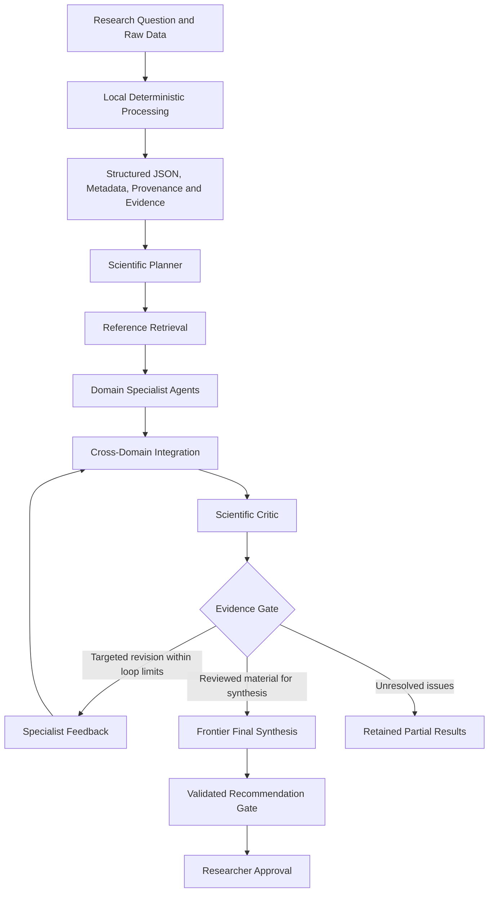

# J.ROS
### Structured scientific reasoning. Traceable evidence. Researcher control.

J.ROS is a research decision-support system that brings research questions, experimental observations, scientific literature, and critical review into a structured workflow.

Its purpose is to help researchers examine mechanisms, compare competing explanations, identify consequential gaps, and plan experiments that distinguish between alternatives. Each stage contributes to an inspectable record connecting the final answer with its supporting material, assumptions, and revision history.

This repository presents the project’s purpose, architecture, and development direction. Product source code is maintained separately in a private repository.

## Why J.ROS?

Scientific research requires more than a plausible answer. Researchers need to understand how an explanation was constructed, whether it fits the experimental context, what alternatives remain, and which experiment would most effectively resolve the question.

J.ROS organizes this work into distinct stages:

- Clarify the research question and its constraints.
- Process experimental files locally.
- Retrieve relevant literature and examine its applicability.
- Analyze the problem through domain-specific perspectives.
- Challenge assumptions, causal interpretations, and experimental designs.
- Revise selected parts of the analysis in response to criticism.
- Produce a synthesis linked to the reviewed evidence.
- Preserve the researcher’s authority over the final decision.

## Core Architecture

### Scientific Planner and Reference

The Scientific Planner organizes the research task, selects relevant specialist perspectives, and plans literature retrieval and local analysis.

Reference retrieval follows the plan and maintains a record of literature candidates. Their relevance and support for specific claims are assessed within the research workflow.

### Domain Specialist Agents

Specialists perform separate initial analyses based on their assigned questions and disciplinary criteria. Initial analyses are separated so that one specialist’s conclusion does not become another specialist’s starting assumption.

Depending on the research question, perspectives may include biomaterials, cell biology, drug delivery, experimental methods, statistics, and immunology.

### Scientific Critic and Evidence Gate

The Scientific Critic examines assumptions, alternative explanations, causal reasoning, and experimental design.

The Evidence Gate checks evidence connections, review coverage, revisions, and exclusions. A bounded feedback loop returns specific issues for targeted revision and subsequent review.

### Final Synthesis and Researcher Approval

Final synthesis brings the reviewed material into a coherent research answer, connecting interpretations with alternatives and proposed experiments.

The Validated Recommendation Gate checks consistency and traceability between the recommendation and the reviewed material. Researcher approval remains a separate human decision.

## Key Capabilities

| Capability | Research purpose |
| --- | --- |
| Research question structuring | Organize objectives, constraints, assumptions, and analytical tasks. |
| Local data processing | Convert raw files into structured observations while retaining provenance. |
| Reference retrieval | Collect literature candidates and preserve their connection to the research question. |
| Domain-specialist analysis | Examine a problem through complementary disciplinary perspectives. |
| Critical review | Challenge explanations and identify experiments that distinguish competing interpretations. |
| Targeted feedback | Revise affected parts of an analysis while preserving the surrounding work. |
| Evidence and result management | Retain source links, revision history, intermediate results, and exportable outputs. |
| Local and Frontier model selection | Configure supported model roles according to the selected execution mode. |

## Knowledge, Experience, and Model Adaptation

J.ROS includes Knowledge RAG and Experience RAG pathways for retrieving project-specific information and recorded review experience.

These retrieval pathways are distinct from model training. Frontier Teacher and LoRA extension paths support separately requested review, training-data preparation, and model adaptation workflows.

The development direction is to make accumulated research experience useful through explicit review, evaluation, and controlled promotion.

## Data Handling and Researcher Control

Raw files are handled through local processing paths. When external AI services are selected, approved structured content is passed to the configured model roles.

Structured content can include research questions, derived measurements, metadata, and retrieved literature. The selected execution mode determines which roles use local models and which use external APIs.

Frontier Final-only is one supported configuration. Other configurations can assign Frontier models to additional research roles.

Researcher control includes reviewing the proposed role allocation, external transmission scope, generated analysis, and final recommendation.

## Research Applications

J.ROS is designed to support tasks such as:

- Exploring mechanisms behind experimental observations.
- Comparing biological, material, and methodological explanations.
- Designing controls that separate competing causal hypotheses.
- Connecting quantitative measurements with literature.
- Prioritizing follow-up experiments.
- Maintaining a traceable record of research reasoning and revision.

Its focus is on supporting scientific judgment and experimental planning, with the researcher responsible for interpreting and acting on the results.

## Development Direction

- Scientific answer quality and citation-support evaluation.
- Broader and more relevant literature retrieval.
- Efficient context use and targeted revisions.
- Researcher-reviewed Knowledge and Experience retrieval.
- Local model selection and adaptation.
- Windows and macOS packaging.
- Clearer evidence inspection and research-result presentation.

## Project Information

**Project:** J.ROS  
**Developer:** 장원영 · [Dr-JWY](https://github.com/Dr-JWY)  
**Documentation baseline:** 4.0.49  
**Repository purpose:** Public project overview  
**Source code:** Maintained privately  
**License:** To be determined
